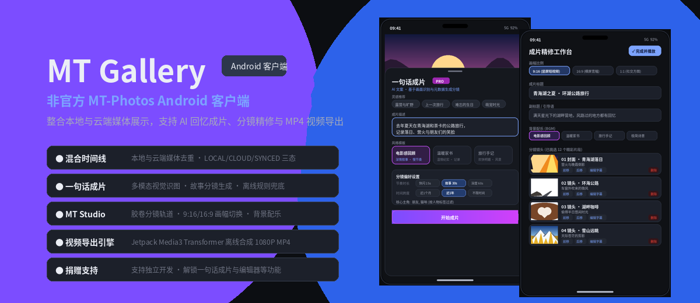
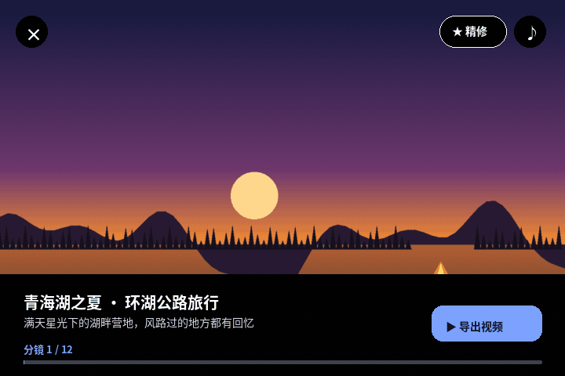
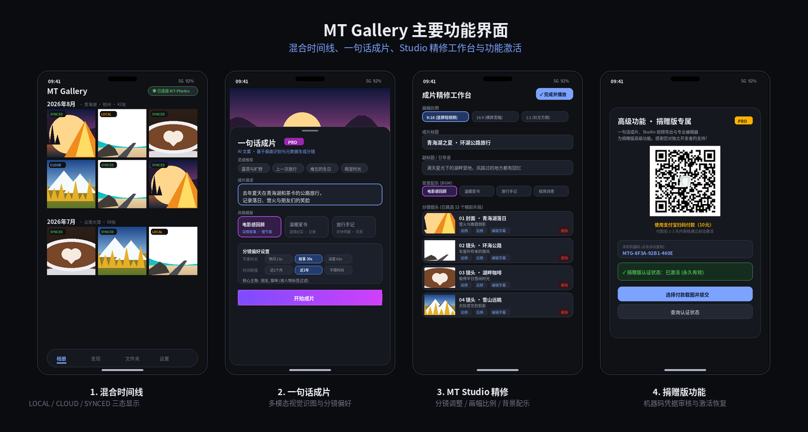
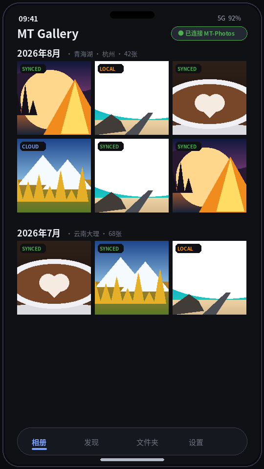
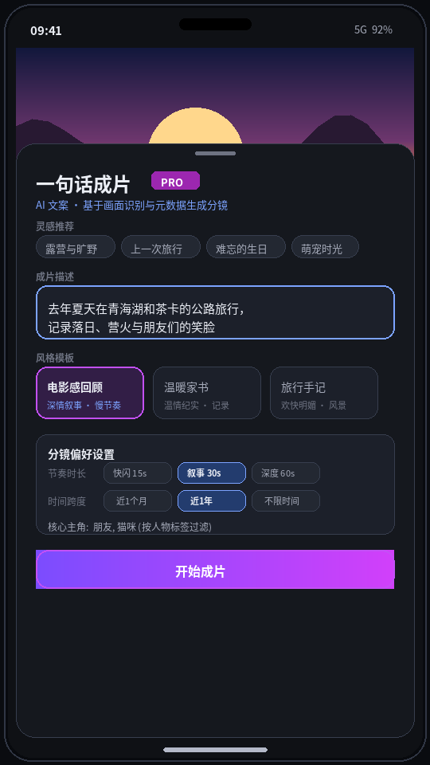
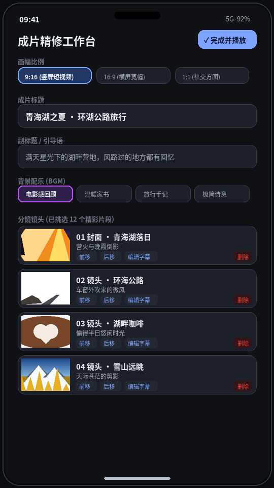

# MT Gallery - 非官方 MT-Photos 安卓客户端

<div align="center">



[](https://opensource.org/licenses/Apache-2.0)
[]()
[]()
[]()
[]()

**Android 客户端 · 本地与云端混合时间线 · AI 回忆成片 · Studio 精修与 1080P 视频导出**

</div>

---

> [!WARNING]
> **免责声明**：本项目处于开发阶段，不建议作为日常唯一相册管理工具使用。使用者需自行承担可能遇到的软件错误或文件丢失风险。

`MT Gallery` 是一款针对开源个人照片管理系统 **[MT-Photos](https://mtmt.tech/)** 开发的非官方 Android 客户端。

项目基于现代 Android 技术栈（Jetpack Compose + Room + WorkManager + Jetpack Media3 Transformer）构建，主要实现本地媒体库与云端相册的整合展示、双向操作同步与后台静默备份，并提供基于多模态大模型的“一句话成片”、Studio 分镜精修及 1080P 硬件加速 MP4 视频导出等功能。

---

## 🎬 演示预览

<div align="center">
  
  <p><i>放映演示：Ken Burns 运镜、分镜字幕浮层、画幅适配与 MP4 导出</i></p>
  <p><a href="docs/assets/demo_slideshow.mp4">▶ 下载演示视频文件 (docs/assets/demo_slideshow.mp4)</a></p>
</div>

---

## 📱 功能界面一览

<div align="center">
  
</div>

---

## 🌟 主要功能

### 1. 本地与云端混合时间线 (Hybrid Timeline)

* **增量扫描与 MD5 去重**：后台自动扫描本地媒体库 (`MediaStore`) 并拉取 MT-Photos 服务器元数据，通过比对文件 MD5 值去重，避免重复展示。
* **三种同步状态标识**：
  * `LOCAL_ONLY`：仅存在于本地设备，尚未备份至云端。
  * `CLOUD_ONLY`：已同步至云端，本地原图已被清理或不存在。
  * `SYNCED`：本地与云端均存在对应文件（MD5 一致）。
* **离线操作队列 (`server_op_tasks`)**：
  * 对云端的操作（如删除、收藏、添加标签、隐藏等）在本地 Room 数据库中排队持久化。
  * 当网络恢复后通过退避策略自动重试，并自动合并短时间内的冲突或重复操作任务。

<div align="center">
  
  <p><i>混合时间线：三态角标标识、服务器连接状态与瀑布流</i></p>
</div>

---

### 2. 一句话成片 (AI Memories)

* **多模态视觉识图与文案生成**：
  * 配合 `mtphotos_sidecar` 增强服务，提取照片轻量 `s260` 缩略图送入多模态大模型（兼容 GPT-4o、Gemini 等接口）；
  * 模型根据画面内容与拍摄信息生成故事分镜、单镜标题与副标题，并自动推荐海报封面。
* **风格模板与灵感词**：
  * 内置电影感回顾、温暖家书、旅行手记、极简诗意等风格模板；
  * 提供露营、旅行、生日、萌宠等常用灵感词辅助输入。
* **分镜偏好设置**：
  * 支持从人物聚类标签中勾选主角；
  * 支持限定时间范围（如近1个月、近1年或全部）；
  * 提供时长节奏档位（快闪 15s / 叙事 30s / 深度 60s）。
* **实况照片与离线兜底**：
  * 支持提取实况照片（Motion Photo）短视频片段混剪；
  * 未配置大模型或网络不可用时，自动回退到基于元数据与本地 CLIP 向量的规则检索模式。

<div align="center">
  
  <p><i>一句话成片：灵感推荐、风格模板与分镜偏好设置</i></p>
</div>

---

### 3. MT Studio 精修工作台与视频导出

* **胶卷分镜轨道 (Filmstrip)**：
  * 放映时可从底部展开精修面板，查看候选分镜序列；
  * 支持调整镜头顺序（前移/后移）、删除不满意片段。
* **字幕二次编辑**：支持直接修改成片标题、副标题引导语及单个分镜字幕。
* **多比例画幅切换**：支持 9:16（竖屏）、16:9（横屏）、1:1（方图）三档比例切换，并做主体居中适配。
* **背景音乐工坊**：内置电影感、温情、旅行、舒缓等多风格背景音乐，支持试听与末尾平滑淡出。
* **Media3 硬件加速 MP4 导出**：
  * 基于 Jetpack Media3 Transformer 与 OpenGL ES 纹理渲染管线；
  * 将 Ken Burns 运镜动效、交叉淡化转场、字幕贴纸与音频离线合成；
  * 导出标准 1080P MP4 视频保存至系统相册，并支持调用系统分享面板。

<div align="center">
  
  <p><i>MT Studio 精修工作台：画幅切换、标题修改、BGM 与分镜重排</i></p>
</div>

---

### 4. 捐赠版功能说明 (Donation Edition)

为了支持项目的持续开发与维护，部分进阶功能纳入捐赠版：

* **捐赠版包含功能**：
  * 一句话成片故事生成；
  * MT Studio 精修与 MP4 视频导出；
  * 独立的图片与视频编辑器（裁剪旋转、OpenGL 调色与视频剪辑）。
* **激活与状态维护**：
  * 赞助方式：支付宝扫码支持 10 元；
  * 激活流程：应用内自动生成设备机器码，上传付款凭据后后台审核激活；
  * 应用每 12 小时自动校验认证状态，重新安装应用后会自动恢复已激活状态。

<div align="center">
  
  <p><i>高级功能认证中心：机器码绑定、凭证上传与状态恢复</i></p>
</div>

---

### 5. 后台自动备份与存储释放

* **WorkManager 后台任务调度**：
  * `SyncWorker`：监听本地相册变动，增量同步元数据；
  * `BackupWorker`：在满足设定条件（连接 Wi-Fi、设备充电中、系统空闲等）时后台流式上传 `LOCAL_ONLY` 媒体文件。
* **本地原图释放**：识别状态为 `SYNCED`（已成功备份）的本地媒体，允许清理原图以释放存储空间，同时保留 Room 本地元数据与缩略图离线浏览。

---

### 6. 探索发现与隐私保护

* **年度回顾海报**：扁平化年度海报展示，叠加 6 栏月份热力分布，支持以幻灯片形式播放年度回忆。
* **分类与地图足迹**：同步 MT-Photos 的人脸聚类与场景标签，地图模式解析 GPS 坐标并按视野聚合展示。
* **私密相册**：支持将敏感照片/视频放入隐藏相册，进入需通过手势图案或 PIN 码解锁。

---

## 🐳 Sidecar 辅助服务部署及使用方法

`mtphotos_sidecar` 是专为 MT Gallery 设计的可选辅助后端服务（基于 FastAPI + 嵌入式 PostgreSQL + Caddy 反代集成）。

### 1. Sidecar 的作用
* **AI 一句话成片与多模态识图**：接收客户端提交的成片需求，并发拉取 MT-Photos 媒体缩略图（`s260`）并调用多模态大模型（兼容 OpenAI 规范）识图生成分镜文案与海报封面推荐；在无模型或调用异常时自动回退到规则与本地 CLIP 向量选片模式。
* **增量同步加速**：内嵌数据库记录媒体库变更日志（changelog），配合客户端实现快速云端增量同步。
* **可选透明代理**：内置 Caddy 反向代理，可将客户端对非 `/sync` 和非 `/admin` 的请求直接转发给 MT-Photos 服务器。

### 2. 准备环境变量 (.env)
部署目录位于仓库中的 [`mtphotos_sidecar/`](mtphotos_sidecar/)。复制配置样例文件：
```bash
cd mtphotos_sidecar
cp .env.example .env
```

根据环境编辑 `.env` 中的核心变量（参考 [`.env.example`](mtphotos_sidecar/.env.example)）：
```ini
# 对外访问端口（默认 8061）
PORT=8061

# MT-Photos 服务器完整地址（供 Sidecar 内部拉取缩略图及反向代理）
# 如两者在同一宿主机且均使用 Docker，可使用 http://host.docker.internal:8063
# 局域网其他设备可使用如 http://192.168.1.100:8063
MT_PHOTOS_URL=http://192.168.1.100:8063

# 管理员密码（用于登录 Web 管理面板 /admin）
ADMIN_PWD=your-admin-password

# Web 会话密钥（修改为任意随机字符串）
SESSION_SECRET=your-random-session-secret

# 内嵌 PostgreSQL 数据库密码（数据目录挂载于 ./data）
POSTGRES_PASSWORD=your-secure-db-password

# 内嵌数据库开关（默认 1，单容器内置运行 Postgres）
EMBEDDED_POSTGRES=1
```

### 3. Docker Compose 部署运行
仓库已提供单容器编排文件 [`docker-compose.yml`](mtphotos_sidecar/docker-compose.yml)（单容器内置 Supervisord 协同管理 Postgres、Uvicorn 与 Caddy）：

* **使用预构建镜像部署（推荐）**：
  ```bash
  docker compose up -d
  ```
  *(镜像地址为 `ghcr.io/kqstone/mt-gallery-sidecar:latest`；发版时该 compose 文件与 sample env 也会同步发布至 GitHub Release 资产中)*
* **或通过源码直接构建**：
  ```bash
  docker compose up -d --build
  ```
* **检查运行状态**：
  ```bash
  docker compose ps
  # 验证健康检查接口
  curl -fsS http://127.0.0.1:8061/sync/health
  ```

### 4. 客户端连接与大模型配置
1. **客户端连接**：
   * 在 Android 客户端打开「设置」->「MT-Photos 增强组件」；
   * 开启「启用增强组件服务器」；
   * 填写 Sidecar 访问地址（例如 `http://192.168.1.100:8061`），点击「测试连接」并完成账号注册。
2. **配置多模态大模型**：
   * 使用浏览器访问 Sidecar 管理页面：`http://<Sidecar-IP>:8061/admin`；
   * 输入 `.env` 中设置的 `ADMIN_PWD` 密码登录；
   * 在「LLM 配置」中填入：
     * **API Base**：兼容 OpenAI 的大模型 API 地址（如官方地址或自建反代）；
     * **API Key**：对应 API 密钥；
     * **Model**：模型名称（推荐填入支持多模态识图的模型，如 `gpt-4o`、`gemini-2.0-flash` 等）；
   * 保存配置后，即可在客户端「发现」->「回忆」中体验“一句话成片”。

### 5. 常见注意点
* **网络连通性**：
  * Sidecar 需要能够稳定访问 `MT_PHOTOS_URL`；
  * 手机客户端需要能够直接访问 Sidecar 映射的 `PORT` 端口（局域网直连或通过 VPN/Tailscale 等远程连通）。
* **模型多模态能力识别**：
  * 模型名称命中 `4o`、`gemini`、`claude`、`vl`、`vision` 等关键字时，Sidecar 会自动启用低分辨率缩略图识图通道；若模型不支持图像或调用出错，系统会自动降级回退至纯文本元数据与规则模式，保证成片不中断。
* **数据持久化**：
  * 数据库文件持久化保存在 `./data` 目录中，容器重启或重建不会丢失配置与同步日志；请保证该目录具备读写权限。

---

## ☕ 赞助支持 (Buy me a coffee)

如果您觉得 `MT Gallery` 对您有所帮助，欢迎赞助支持独立开发。捐赠 10 元可解锁捐赠版全部高级功能。

<div align="center">
  
  <p><b>支付宝扫码支持（10元解锁捐赠版）</b></p>
  <p><i>付款后可在客户端“关于 -> 高级功能”中提交凭证，审核通过后激活</i></p>
</div>

---

## 👥 作者与致谢

* **作者**：[kqstone](https://github.com/kqstone)
* **致谢**：
  * [MT-Photos](https://mtmt.tech/) 服务端
  * 部分代码及方案由 **Claude Code** 与大语言模型辅助重构优化

---

## 📜 开源协议

本项目基于 **[Apache License 2.0](https://www.apache.org/licenses/LICENSE-2.0)** 开源协议发布。

* 本项目为第三方开源客户端，与 MT-Photos 官方团队无商业关联或直接隶属关系；
* 允许学习、修改或二次开发，请保留原作者的版权声明及许可协议。
